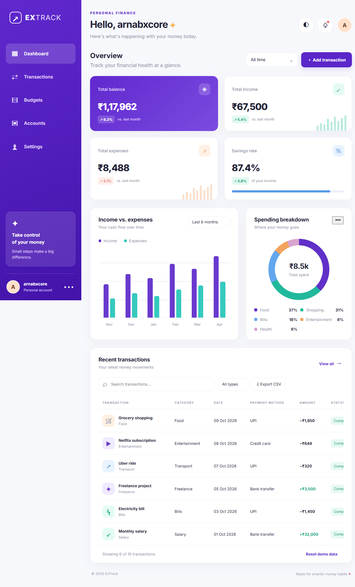
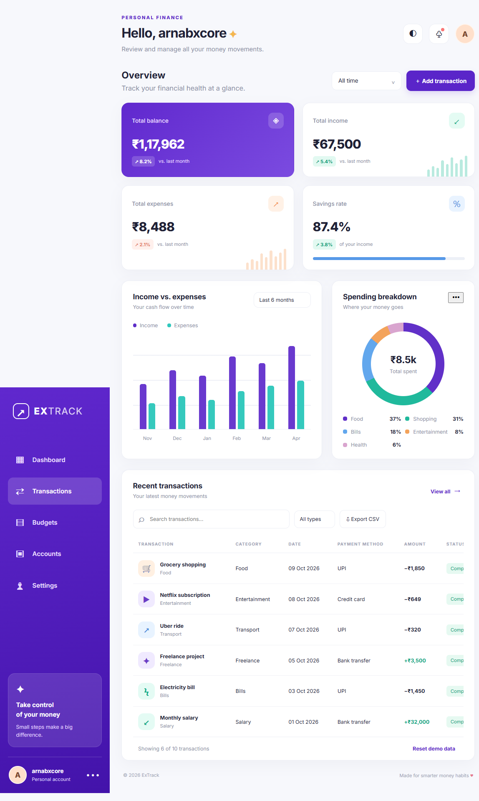
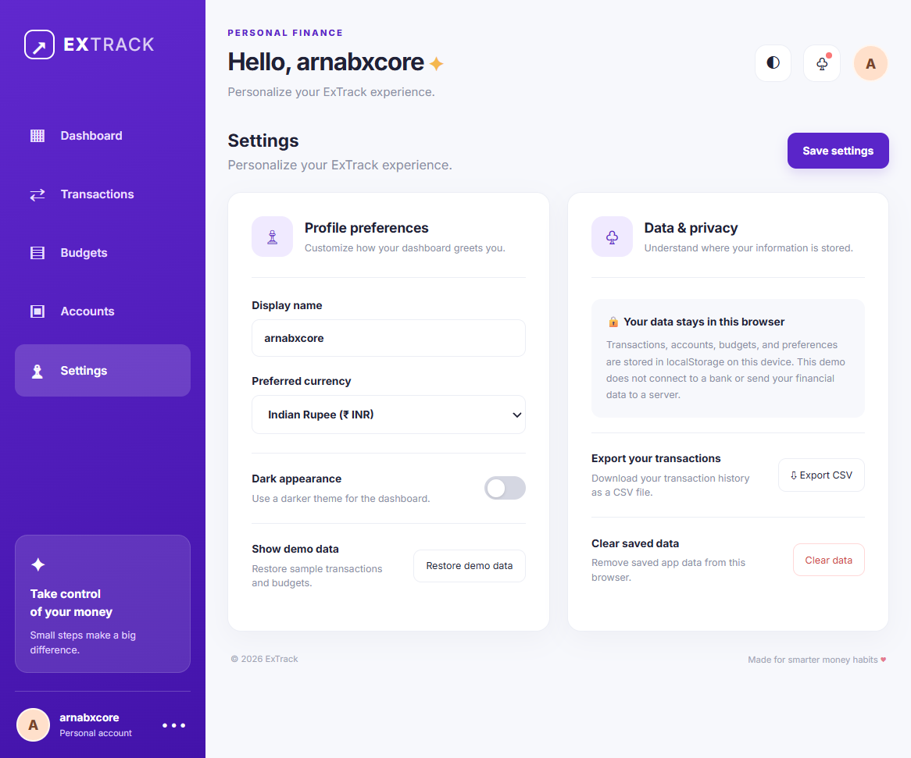

# ExTrack — Personal Expense Tracking Dashboard

A responsive personal expense tracking dashboard built with **HTML, CSS, and vanilla JavaScript**. ExTrack helps users review sample income and expenses, organize budgets, and keep track of account balances through a clean dashboard interface.

## ✨ Features

### Dashboard
- Financial summary cards for balance, income, expenses, and savings rate
- Income-versus-expenses chart
- Spending breakdown by category
- Responsive layout for desktop, tablet, and mobile

### Transactions
- Add and delete income or expense transactions
- Search transactions by description, category, payment method, or type
- Filter transactions by month and transaction type
- Export transaction data to CSV

### Budgets
- Create monthly budgets for spending categories
- View spending against category limits
- Track used and remaining budget with progress bars
- Highlight categories that are close to or over budget

### Accounts
- Add and remove bank, cash, credit-card, and digital-wallet accounts
- View account balances and total balance across accounts

### Settings
- Change the display name
- Choose a display currency (INR, USD, EUR, or GBP)
- Toggle light and dark modes
- Restore demo data, export transactions, or clear saved application data

## 🛠️ Built With

- **HTML5** — page structure
- **CSS3** — styling and responsive layout
- **JavaScript** — interactions, charts, browser storage, and CSV export
- **localStorage** — stores demo transactions, budgets, accounts, and preferences in the browser

## 📁 Project Structure

```text
expense-tracking-dashboard/
├── index.html
├── style.css
├── script.js
├── README.md
├── .gitignore
├── LICENSE
└── screenshots/
    ├── dashboard.png
    ├── transactions.png
    ├── budgets.png
    ├── accounts.png
    └── settings.png
```

## ▶️ Run Locally

1. Download or clone this repository.
2. Open the project folder in Visual Studio Code.
3. Open `index.html` in your browser.
4. Alternatively, install the **Live Server** extension in VS Code, right-click `index.html`, and choose **Open with Live Server**.

No build tools, package installation, or backend server are required for the demo.

## 📸 Screenshots

Add screenshots of your own running project to the `screenshots/` folder, using the filenames below. Once the images are uploaded, GitHub will display them in this README.

### Dashboard


### Transactions


### Budgets


### Accounts


### Settings


> If you have not added the screenshots yet, these image previews will not appear until the files exist in the repository.

## 🔐 Data and Privacy

- This is a front-end portfolio project with fictional demo data.
- The app stores information in the browser using `localStorage`.
- It does not connect to real bank accounts, provide authentication, or send financial data to a server.
- Selecting a different currency changes the display format only; it does not convert values using live exchange rates.
- Avoid entering real sensitive financial information.

## 🧭 Possible Future Improvements

- Add transaction editing and custom date-range filters
- Add recurring transactions and budget rollover
- Add automated tests and accessibility improvements
- Connect a backend API and database for a multi-user version

## 📄 License

Distributed under the MIT License. See [`LICENSE`](LICENSE) for details.
